# ModelRail — High-Level Design (HLD)

**Phase 1 of 2** — High-Level Design only. Low-Level Design (interfaces, schemas, APIs, algorithms) is a separate follow-up phase.

**Status:** Draft 3 — MVP decisions applied; LLD phase started (`docs/lld-01.md`)
**Audience:** Senior/Staff backend engineering review
**Author role:** Staff Backend Engineer / Architect

---

## 0. Document conventions

| Label | Meaning |
|---|---|
| **[Confirmed]** | Requirement stated explicitly in the original brief |
| **[Decided]** | Owner decision made during HLD review (binding unless reopened) |
| **[Recommendation]** | Architectural proposal, open for challenge |
| **[Assumption]** | Made explicit because the requirement was not stated |
| **[Unresolved]** | Needs a decision before LLD; options and a recommendation are given |
| **[MVP]** / **[Future]** | In scope for the milestone plan (§23) / deliberately deferred |

### 0.1 Changes from Draft 1

1. **Money path rewritten (§15):** bounded overspend (not "zero"); two short transactions per request and *no transaction open across a provider call*; **completion rule** — usage and settlement are made durable atomically *before* the client can observe completion, including before the terminal `[DONE]`; background workers are recovery/reconciliation only.
2. **Fallback is opt-in** (§10, §11); eval traffic never falls back; responses always state the model actually served.
3. **Response validation/redaction applies to non-streaming only** (§13).
4. **Eval engine runs on the MacBook**; results arrive via a narrowly scoped ingest endpoint (§9, §17).
5. TPM limiter and period token quota are separate controls (§14, §15); per-tenant concurrency fairness (§16, §20); API-key flood protection (§14).
6. Eval scorecards carry confidence intervals and model-version tracking (§12); routing selection is a constraint pipeline (§11).
7. Passive-first health (§20); shared reverse proxy and static dashboard (§21); flat MVP replaced by milestones M0–M8 (§23).
8. Draft 1 leaks of LLD detail (SQL shape, scoring formula, queue mechanics) removed; fault-injection IDs renamed `FI-n`; diagram bugs fixed.

**Draft 3 — resolved decisions (this revision):**

9. **Open questions closed as decisions** (§26 now records decisions, not options): dashboard operator-only (`platform_admin`), operator-created tenants, `modelrail-task` hint with `general` default, Gemini native adapter in M5, missing streaming usage estimated and flagged, code-exec scorer Mac-only stretch, LLM-as-judge deferred, key revocation immediate for new requests in the single instance, VPS tracing off by default, integer micro-dollars, inference idempotency deferred, response caching out of MVP, fallback via opt-in tenant-defined groups, bounded overspend, strict settlement-failure policy, orphan holds released with platform-absorbed leakage, deterministic constraint-pipeline routing, output-validation failure charged with typed error and no auto-retry, minimal spend-capped half-open probe, daily off-VPS backups with 24-hour RPO target.
10. **Deployment corrections (§21):** the VPS has **not been purchased** — 8 GB/4 vCPU/100 GB SSD are target specifications, not existing infrastructure. One shared reverse proxy for all applications; its software choice stays open until provisioning; ModelRail does not claim ports 80/443; PostgreSQL and Redis remain private; the dashboard stays a static build. Proxy-specific and host-specific decisions are deferred until provisioning.

---

## 1. Product overview and system boundaries

### 1.1 What ModelRail is

**[Confirmed]** A multi-tenant platform with two capabilities:

1. **LLM Gateway** — a unified OpenAI-compatible API over multiple external providers (DeepSeek primary, Gemini secondary, Mock for development), with authentication, rate limiting, budgeting, metering, routing, guardrails and provider reliability handling.
2. **Model Evaluation Platform** — an independent Python benchmarking engine that compares models on quality, latency and cost, and feeds results back into gateway routing.

They are **architecturally connected** (eval results influence routing; eval traffic flows through the gateway) but **independently operable** (the gateway serves production traffic with zero dependency on the evaluator).

### 1.2 System context

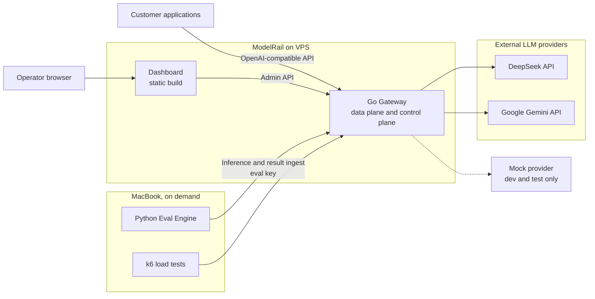

### 1.3 In scope / out of scope

| In scope | Out of scope |
|---|---|
| OpenAI-compatible `chat.completions` surface | Real payment processing |
| Multi-tenant keys, limits, budgets, ledger | Multi-region / active-active HA |
| Deterministic routing + eval-driven routing | LLM-based request classification, semantic caching |
| Essential guardrails + pluggable optional tier | Training or hosting local LLMs |
| Provider reliability (retry, breaker, opt-in fallback, backpressure) | Kubernetes, Kafka, extra microservices |
| Eval engine: datasets, scoring, reports, scorecards | Full MLOps platform |
| Prometheus + Grafana + OTel | Paid observability platforms |
| Docker Compose on one shared VPS | SLA-backed production commitments |

**[Assumption]** "Customer" = tenant developers integrating the API. There is no self-service signup; tenants are created by the operator.

**Dashboard audience — [Decided] (Q1).** The MVP dashboard is **operator-only**, authenticated as `platform_admin`. A customer-facing portal is **[Future]** — deferred because it adds an entire tenant-scoped authorization surface. Customers still see per-request usage/cost in API responses (D3).

---

## 2. Functional requirements

### 2.A Gateway **[Confirmed]**

| # | Requirement | Notes |
|---|---|---|
| F1 | OpenAI-compatible inference API | Wire-compatible `chat.completions` |
| F2 | Multiple providers behind a common abstraction | DeepSeek, Gemini, Mock |
| F3 | Request/response normalization | Internal canonical schema; adapters map in/out |
| F4 | SSE streaming with client cancellation | Cancellation propagates upstream |
| F5 | Explicit model selection | **[Decided]** explicit means *that model*, no silent substitution (§11) |
| F6 | Automatic model routing | Deterministic, rules-based |
| F7 | Model capability registry | Context length, tools, JSON mode, modality, pricing |

### 2.B Multi-tenancy and auth **[Confirmed]**

| # | Requirement |
|---|---|
| F8 | Tenant/customer management |
| F9 | Virtual API keys, secure hashing and validation |
| F10 | Tenant isolation |
| F11 | Per-tenant and per-key permissions, incl. model/provider restrictions |
| F12 | Per-tenant and per-key request rate limits |
| F13 | Per-tenant and per-key token quotas — **[Decided]** split into two controls: a short-window **TPM limiter** (ephemeral) and a **period token quota** (durable) |

### 2.C Metering, billing, budgets **[Confirmed]**

| # | Requirement | Notes |
|---|---|---|
| F14 | Input / output / cached-token metering | **[Recommendation]** canonical usage also carries **reasoning tokens** (§10.3) |
| F15 | Versioned per-provider, per-model pricing | Must support tiered pricing |
| F16 | Per-tenant usage reports | |
| F17 | Customer spending budgets | |
| F18 | Budget reservation before inference, settlement after | |
| F19 | Immutable wallet/usage ledger | |
| F20 | Idempotent financial operations | |
| F21 | Eval usage separated from customer usage | |

### 2.D Routing **[Confirmed]**

| # | Requirement |
|---|---|
| F22 | Explicit routing; rules-based automatic routing |
| F23 | Cost-, capability-, latency-, health-aware routing |
| F24 | Evaluation-driven routing from stored benchmark results |
| F25 | No LLM call in the routing path |

### 2.E Guardrails **[Confirmed]**

| # | Requirement | Notes |
|---|---|---|
| F26 | Input validation, max payload sizes | Essential |
| F27 | Per-tenant model restrictions, token/output limits | Essential |
| F28 | Optional PII redaction, prompt-injection detection, moderation | Optional tier |
| F29 | Tool-call restrictions | Essential |
| F30 | Output / structured-response validation | **[Decided]** non-streaming only (§13) |

### 2.F Reliability **[Confirmed]**

| # | Requirement | Notes |
|---|---|---|
| F31 | Provider health checks | **[Decided]** passive-first |
| F32 | Bounded retries, circuit breakers, timeouts | |
| F33 | HTTP 429 handling, provider-side and gateway-side | |
| F34 | Controlled fallback routing | **[Decided]** opt-in only |
| F35 | Concurrency management and backpressure | Includes per-tenant fairness |
| F36 | Graceful client disconnect | |
| F37 | Defined mid-stream failure behaviour | §16.3 |

### 2.G Evaluation **[Confirmed]**

| # | Requirement | Notes |
|---|---|---|
| F38 | Datasets: coding, reasoning, structured extraction | |
| F39 | Submits prompts to gateway over HTTP with explicit model selection | |
| F40 | Correctness scoring per dataset type | |
| F41 | Latency, token and cost measurement | Server-reported latency is authoritative (§9.3) — **[Decided]** |
| F42 | Comparative reports; results submitted to Go | Via restricted ingest endpoint (§9.2) |
| F43 | Router consumes stored evaluation results | |
| F44 | Evaluation is a separate workflow | |
| F45 | Dedicated eval identity: own usage, spend and request limits | |

### 2.H Observability, testing, dashboard **[Confirmed]**

| # | Requirement |
|---|---|
| F46 | Metrics: RPS, P50/P95/P99, provider errors, 429s, tokens, fallbacks, active streams |
| F47 | OTel tracing across auth → routing → provider → settlement |
| F48 | slog structured logging, correlation IDs, prompt/secret-safe |
| F49 | k6 load tests: overhead separate from provider latency, concurrent streams, resource use |
| F50 | Fault injection: provider timeout/429/outage, Redis, PostgreSQL, client disconnect, concurrent budget operations |
| F51 | Dashboard: tenants, keys, providers/models, usage/cost, budgets, model comparison, eval history, provider health |

**[Derived, Recommendation]** — implied by the above; each can be cut:

- D1: `GET /v1/models`.
- D2: Idempotency keys on admin/financial operations.
- D3: Per-request usage, cost and routing metadata in the response.
- D4: Routing decision explainability (reason codes).
- D5: Admin wallet top-up (no payment processor).
- D6: Audit log for admin mutations.
- D7: **Served-model transparency** — every response states the model and provider that actually served it.
- D8: **Eval ingest endpoint** (§9.2).

---

## 3. Non-functional requirements

### 3.1 Properties and mechanisms **[Confirmed properties]**

| Property | Mechanism |
|---|---|
| Low gateway overhead | In-process L1 caches on the hot path; exactly two short DB transactions per request (reserve, settle); no DB connection held during provider calls |
| High concurrency | Goroutine-per-request, bounded semaphores, streaming without buffering whole responses; DB pool usage is only during two short transactions, so concurrent streams do not consume DB connections |
| Reliable streaming | Commit-point discipline; context propagation; detached settlement context; bounded write buffers |
| Strong tenant isolation | Tenant-scoped persistence layer; per-tenant concurrency and rate controls; separate eval identity; encrypted provider secrets |
| Secure API and secrets | Peppered key hashes, constant-time compare, flood protection, encrypted provider secrets, log redaction |
| Correct, idempotent accounting | Reserve then atomic settle, append-only ledger, idempotency by request, completion rule, recovery + reconciliation (§15) |
| Consistent usage tracking | Usage event and settlement written atomically; reconciliation checks ledger vs wallet |
| Fault tolerance | Circuit breakers, opt-in fallback, explicit degraded modes per dependency (§20) |
| Observability | RED + USE metrics, sampled traces, redacted structured logs, cardinality discipline |
| Maintainability | Modular monolith with enforced dependency direction |
| Cost and resource efficiency | One shared VPS, no broker, no k8s, no Node runtime, on-demand heavy components |

### 3.2 Benchmarks vs production SLOs

**[Recommendation]** I do not invent availability or throughput commitments. The project publishes measured **portfolio benchmarks** and states **hypothetical production SLOs** with assumptions.

| Type | Item | Basis |
|---|---|---|
| Portfolio benchmark | **Gateway overhead**, reported as two numbers: *pre-provider overhead* (adds to TTFT) and *completion-tail overhead* (the settle commit before completion). Excludes provider time. | The numeric targets are set **after the M0 fsync spike**, because both include one synchronous PostgreSQL commit on shared VPS storage (target specs; the VPS is **not yet purchased**). The *principle* is that overhead should be a small fraction (guideline: ≲1%) of a typical 1–2 s LLM call. |
| Portfolio benchmark | Concurrent sustained SSE streams: report the measured saturation point on 4 vCPU rather than promising one | T4 |
| Portfolio benchmark | **Accounting correctness:** overspend never exceeds the documented bound; ledger invariants hold under concurrency and crash tests | Binary criterion (T6, FI-9..11) |
| Production SLO (hypothetical) | 99.9% monthly availability | Needs ≥2 gateway instances, managed Postgres, multi-AZ — explicitly **not** in this deployment. A single instance means every deploy is a brief outage (accepted, mitigated by drain, §20.5) |

**[Assumption]** End-to-end latency is provider-dominated, so the meaningful engineering metrics are gateway overhead and gateway-added TTFT.

---

## 4. Scope, assumptions and constraints

### 4.1 Assumptions

1. Single gateway instance for MVP; stateless-enough design keeps a path to N instances.
2. Money is integer micro-dollars; single currency.
3. Prepaid wallet of admin-issued credits; no real payment flow.
4. Prompt/response content is **not stored** by default.
5. SSE is the only streaming transport.
6. Dashboard users are operators (see Q1).
7. The ~$5 provider budget funds eval runs and manual experiments only; load tests use the mock provider.
8. **Free-tier provider keys are used for evals only**, never for customer traffic (free-tier terms may permit training on submitted data).

### 4.2 Constraints **[Confirmed]**

- Target VPS (**not yet purchased** — treat as target specifications): 8 GB RAM, 4 vCPU, 100 GB SSD, to be **shared with 4–5 other apps**; 32 GB MacBook for development, load tests and evals; ~$5 LLM budget.
- No local LLMs, no paid tooling, open-source observability only, Docker Compose.
- No Kafka, Kubernetes, LangChain/LangGraph for gateway functionality, extra databases or message broker without actual need.

### 4.3 Phasing

Phase 1 = this HLD. Phase 2 = LLD after the open questions (§26) are closed.

---

## 5. High-level architecture

### 5.1 Container diagram

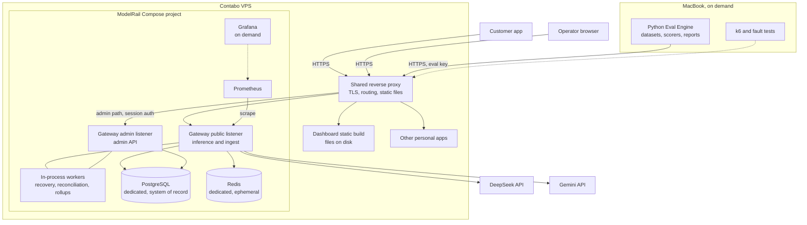

**[Recommendation]** One Go binary exposes two listeners (public, admin) with separate middleware chains. The dashboard is a **static build served from disk by the shared proxy** — no dashboard container and no Node runtime on the VPS. **[Decided]**

### 5.2 Why a modular monolith

**[Recommendation]** One binary hosts data plane, control plane and workers. At this scale network boundaries cost tracing, deployment and transactional simplicity and buy nothing. Internal boundaries (§8) keep the future seams at the provider adapter and the admin API.

---

## 6. Data plane vs control plane

| Concern | Plane | Notes |
|---|---|---|
| `/v1/chat/completions`, `/v1/models` | **Data plane** | Must survive control-plane unavailability |
| Auth, rate/TPM limits, concurrency admission | Data plane | Reads in-process snapshots; Redis for shared counters |
| Guardrails, routing | Data plane | Versioned snapshots, no DB joins on the hot path |
| Budget reservation and settlement, usage events | Data plane | Correctness-critical, PostgreSQL only |
| Tenant/key/provider/model/pricing/policy configuration | **Control plane** | Admin API writes PostgreSQL, bumps versions |
| Wallet top-up, audit log | Control plane | |
| Eval result **ingest** and approval | Control plane | Ingest is reachable on the public listener with a restricted scope (§9.2) |
| Recovery and reconciliation workers, rollups | Control plane (background) | |
| Passive health computation | Data plane (in-process) | Produced from live traffic |
| Reports, dashboards | Control plane | Read rollups, never on the hot path |
| Prometheus, Grafana, OTel | Observability plane | Out of the request path |

**Consistency between planes:** the data plane serves **versioned in-process snapshots** (key context, policy, pricing, routing table). Because the admin API lives in the same binary, **invalidations are synchronous in-process** on a single instance — key revocation takes effect immediately for new requests. Periodic refresh from PostgreSQL is the safety net, and Redis pub/sub is the invalidation path if instances are ever added. Stale-but-valid beats unavailable.

---

## 7. Major component responsibilities

| Component | Responsible for | NOT responsible for |
|---|---|---|
| **Go Gateway (data plane)** | AuthN/Z, limits, guardrails, routing, provider calls, streaming, retries/breakers, reservation, settlement | UI, report generation, eval scoring |
| **Go Admin API (control plane)** | CRUD for tenants/keys/providers/models/pricing/policies/budgets, eval ingest + approval, reports | Serving inference |
| **In-process workers** | Orphan-reservation recovery, ledger reconciliation, rollups, scorecard → routing-table rebuild | **Routine settlement** (the request path settles inline) |
| **Python Eval Engine (MacBook)** | Datasets, run orchestration through the gateway, scoring, reports, result submission | Customer traffic, direct DB access |
| **Dashboard (static SPA)** | Operator UI over the admin API | Business logic |
| **PostgreSQL** | System of record: identity, config, ledger, usage, scorecards | Rate-limit counters |
| **Redis** | Rate/TPM counters, invalidation pub/sub, short-lived shared state | Financial truth; primary key/config cache |
| **Shared reverse proxy** | TLS, host/path routing, static files, security headers | Application auth, API rate limiting |
| **Prometheus + Grafana** | Metrics storage and visualization | Logs and traces |
| **Mock provider, Toxiproxy** | Deterministic fake provider and network fault injection (dev/test only) | Anything on the VPS |

---

## 8. Go gateway architecture (module level)

### 8.1 Module map

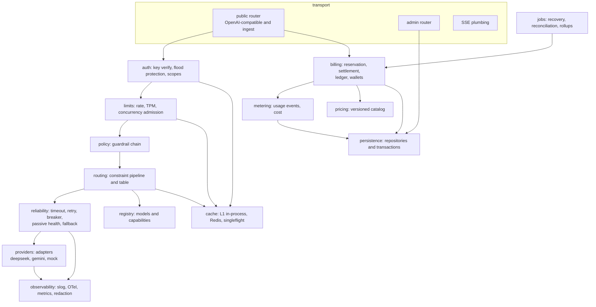

### 8.2 Responsibilities and dependency rules

| Module | Responsibility | Must NOT depend on |
|---|---|---|
| `transport` | OpenAI wire format, SSE framing, request IDs, error mapping | providers directly |
| `auth` | Key parsing and verification, negative caching, scope checks | billing, routing |
| `limits` | Request rate, TPM, per-tenant/per-key concurrency | providers |
| `policy` | Ordered guardrail stages (allow, deny, transform, tag) | providers |
| `routing` | Candidate filtering, selection, decision record | transport |
| `providers` | Adapter per provider: invoke, stream, normalize usage and errors | billing, auth |
| `reliability` | Timeouts, bounded retry, breakers, passive health, opt-in fallback orchestration | transport |
| `billing` | Reservation, atomic settlement, ledger, wallets, recovery logic | providers |
| `metering` | Usage event construction and cost computation | transport |
| `persistence` | All SQL and transaction boundaries | everything else |
| `cache` | L1 caches, Redis access, singleflight | — (leaf) |
| `jobs` | Recovery, reconciliation, rollups, routing-table rebuild | transport |
| `observability` | slog, redaction, OTel, metrics | — (leaf) |

**[Recommendation] Rules that keep the monolith honest:**
1. Only `persistence` contains SQL; transaction boundaries are declared there.
2. **No transaction or row lock is ever held across a provider call.** Billing exposes two short operations (reserve, settle) and nothing that spans the call.
3. `providers` never learns about tenants or money; it returns normalized usage and `billing` prices it.
4. `transport` is the only module that knows the OpenAI wire format.
5. `observability` and `cache` are leaves.

**[Recommendation] Runtime model:** goroutine per request; bounded semaphores; fixed small worker pool for jobs; **every goroutine has panic recovery** (workers share the process with the data plane); no unbounded channels on the hot path.

---

## 9. Python evaluation architecture

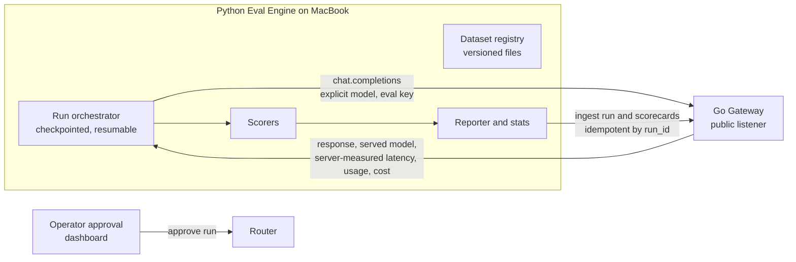

### 9.1 Components

| Component | Responsibility |
|---|---|
| **Dataset registry** | Versioned sets (`coding`, `reasoning`, `structured_extraction`) with manifest: version, item count, scoring method. Files in the repo. Small by design (tens of items) given the budget. |
| **Run orchestrator** | `(dataset_version × models × repeats)`; explicit model selection; concurrency limit; run-level spend cap; per-item checkpoint file. **Asserts `served_model == requested_model` and discards mismatches.** |
| **Scorers** | `structured_extraction`: schema validity + field-level match; `reasoning`: exact/numeric/regex; `coding`: unit-test pass rate — **[Decided Q6]** sandboxed executor is a **Mac-only stretch goal** (M7 stretch); **[Decided Q7]** LLM-as-judge is disabled by default, a budget-gated **[Future]** feature. |
| **Reporter** | Quality with **confidence intervals**, P50/P95 latency, TTFT, cost per request, cost per correct answer; JSON for the platform, Markdown for humans. |
| **Submitter** | Posts run + scorecards to the ingest endpoint, idempotent on `run_id`. HTTP only — never touches PostgreSQL. |

### 9.2 Evaluation identity and ingest **[Decided: evaluator runs on MacBook]**

- Dedicated tenant `eval-org` with its own wallet and hard spend cap, its own rate/TPM/concurrency limits, and usage tagged `channel=eval` (excluded from customer reports, visible in eval reports).
- The eval key carries **only** two scopes: `inference` and `eval:submit`. No admin scopes.
- **Fallback is hard-disabled for the eval tenant by gateway policy** (server-enforced, not a client convention).
- **Ingest endpoint:** a narrow control-plane write path exposed on the *public* listener, accepting only run reports under the `eval:submit` scope. The admin listener stays reachable only through the proxy's authenticated admin route. Ingested runs are **inert until an operator approves them** in the dashboard, so a leaked eval key cannot influence routing.
- The same gateway code path serves eval and customer traffic — deliberately; isolation is by identity and policy.

### 9.3 Execution model and measurement validity

- **On demand from the MacBook**: no cron, no VPS memory, no code-execution sandbox on the shared host, no Docker-socket exposure.
- **[Recommendation] Server-reported latency/TTFT is authoritative.** Client wall-clock from a Mac over the internet to the VPS includes variable network time; the gateway returns provider latency and TTFT in response metadata and the evaluator records those, keeping client-observed timing as a secondary field.
- The Mac must be online during a run; runs are resumable from the checkpoint.

---

## 10. Provider integration and abstraction

### 10.1 Abstraction

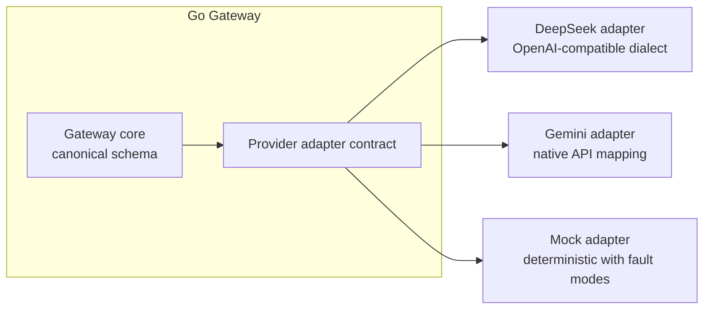

**Adapter contract responsibilities** (conceptual; signatures belong to LLD):
1. **Capability declaration** feeding the registry.
2. **Invocation**: unary and streaming, with deadline and cancellation.
3. **Normalization**: canonical request to provider dialect and back, including a **usage breakdown of input, cached-input, output and reasoning tokens**.
4. **Error taxonomy** mapping.
5. **Probe**: a minimal request used only for half-open circuit recovery and idle-provider checks (§20.2).

### 10.2 Error taxonomy and fallback eligibility **[Recommendation]**

| Class | Examples | Retry same provider | Fallback | Client sees |
|---|---|---|---|---|
| `retryable_transient` | 5xx, reset, timeout before first content | Yes, bounded | **Only if the request has an opted-in fallback group** and still pre-commit | typed error after exhaustion |
| `throttled` | provider 429 | Yes, honouring `Retry-After` within deadline | Only if opted-in, pre-commit | 429 + `Retry-After`, typed `provider_throttled` |
| `terminal_request` | 400, provider 401, context too long | No | No | typed 4xx |
| `terminal_policy` | guardrail deny, budget, quota, rate limit | No | No | typed 4xx |
| `degraded_stream` | failure after commit | No | **Never** | SSE `error` event, partial usage recorded |

### 10.3 Provider notes

*Provider-behaviour claims below come from memory and are **verified in M0** against current provider documentation.*

- **DeepSeek (primary):** OpenAI-compatible dialect. Cached tokens are billed separately. The reasoning model emits reasoning content in a non-standard stream field and bills reasoning tokens as output. **[verify]** Under load it may keep connections open with keep-alive lines rather than returning a clean 429, which affects timeout design (§20.2).
- **Gemini (secondary):** **[Decided Q4]** native provider adapter, implementation in **M5**. Reports thinking tokens separately; pricing can be tiered by prompt size **[verify]**.
- **Usage reporting is forced upstream.** For streaming, the gateway **always requests final usage from the provider regardless of what the client asked**, and strips the usage chunk from the client stream if the client did not request it. Otherwise estimation (§15.8) becomes the normal case instead of the exception.
- **Mock:** first-class, scriptable: latency distributions, token counts, drip rate, fault modes — 429 with `Retry-After`, 5xx, timeout, hang, mid-stream drop, and **keep-alive without content progress**. All load and failure tests run against it.
- **Tool calls:** Gemini returns whole function calls where OpenAI-style providers stream deltas. This is the hardest normalization; MVP supports tool calls through DeepSeek first (§27 R2).

---

## 11. Model routing architecture

### 11.1 Request modes **[Decided: explicit-model fallback is opt-in]**

| Mode | Candidates | On provider failure |
|---|---|---|
| **Explicit model**, no fallback group | exactly that model | Retry the same model/provider within bounds, then fail with a typed error. Never substitutes another model. |
| **Explicit model + opted-in fallback group** | the requested model first, then members of the group in order | Fallback pre-commit only, within the group |
| **Automatic** (`model: "auto"`) | all models allowed for tenant/key that pass the filters | Re-selection among remaining candidates pre-commit |

**Fallback groups** are an ordered list of models the tenant has explicitly allowed to substitute for each other. **[Decided]** defined in tenant/key policy; a request may *narrow* the group but never widen it. A fallback target must also pass the tenant's **provider allowlist** — switching vendors implies sending data to a different processor, so it requires consent.

### 11.2 Selection pipeline (deterministic constraint pipeline) **[Decided — not weighted scoring]**

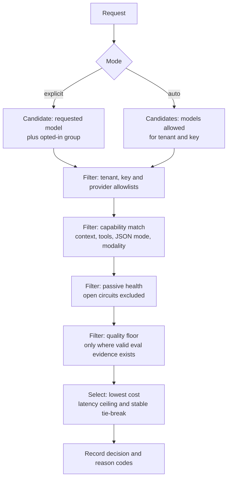

Why a pipeline instead of a weighted score: each stage is explainable, individually testable, needs no weight tuning against noisy eval data, and every decision produces reason codes (`quality_floor_applied`, `no_eval_evidence`, `only_candidate`, `cheapest_of_n`). A weighted-score router is the **[Future]** alternative once there is enough data to tune it responsibly.

For explicit mode without a group the pipeline degenerates to validation filters (allowlist, capability, health) on one candidate.

### 11.3 Signals

| Signal | Source | Freshness |
|---|---|---|
| Cost | Pricing catalog (versioned) | On config change |
| Latency | Rolling observed TTFT/latency per provider × model (passive) | Minutes |
| Health | Breaker state and passive error/latency signals | Seconds |
| Quality | **Approved** eval scorecards per task class, with confidence and version metadata (§12) | On approval |

### 11.4 Task class without an LLM **[Decided]**

No classifier call **[Confirmed]**. The **explicit `modelrail-task` hint** is the mechanism; the default class is `general`. Structural heuristics (schema present → extraction, tools present → tool use) are **deferred until evaluation evidence justifies them** (post-M7 review).

### 11.5 Decision recording and transparency

Every request records chosen model, candidate set, policy version and reason codes. **The response always states the model and provider that actually served it (D7)**, plus the routing reason (D4). A request that was served by a fallback target says so explicitly.

---

## 12. Evaluation-driven routing workflow

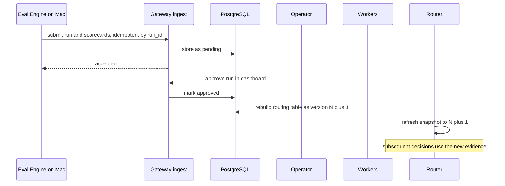

**Lifecycle:** ingest → pending → operator approval → routing-table rebuild → snapshot refresh → decisions annotated with `policy_version`. **Routing changes are data, not deployments**; rollback = revert to the previous routing-table version.

### 12.1 Evidence quality **[Decided: confidence and model-version tracking]**

A dataset of tens of items across a few non-deterministic models is statistically weak, and provider aliases (e.g. a "latest" alias) can silently change what is behind them. Scorecards therefore carry:

- **Sample size, repeat count and a confidence interval** (bootstrap is sufficient). Runs use the lowest-temperature setting available.
- **Model identity:** requested alias, the provider-reported model version or fingerprint **where the provider exposes one**, dataset version and run date.
- **Expiry:** a scorecard becomes stale after a configured age or when the provider-reported version changes.

The router uses a scorecard only if it is approved, fresh, above a minimum sample size, and the difference between candidates **exceeds the confidence-interval overlap**. Otherwise the quality stage records `no_eval_evidence` and selection falls through to cost and latency. A two-item difference is noise and must never reroute traffic.

### 12.2 Auto-routing evaluation **[Recommendation, stretch]**

Besides per-model runs, an evaluation mode with `model: "auto"` measures what the router actually decides, as a routing regression test. Failure-triggered re-routing stays disabled for eval; the served model is recorded rather than asserted.

---

## 13. Guardrails and policy enforcement

### 13.1 Two tiers

| Tier | Controls | Default |
|---|---|---|
| **Essential gateway security** | Max payload size; content-type and JSON validity; message-count caps; model and provider allowlists; `max_tokens` clamp; stop-sequence limits; tool-call permissions; output length caps | **On** |
| **Optional AI safety** | PII detection/redaction; prompt-injection heuristics; content moderation | **Off**, per-tenant opt-in, pluggable |

### 13.2 Streaming limits **[Decided]**

Bytes already sent cannot be recalled. Therefore:

| Control | Non-streaming | Streaming |
|---|---|---|
| Input validation, redaction, moderation of the *request* | Yes | Yes (before the provider call) |
| Output length and token caps | Yes | Yes (enforced by cutting the stream) |
| **Structured-output / schema validation of the response** | **Yes** | **No** — the gateway relies on provider-native JSON mode and can only *tag* the finished response (`validation_failed`) for telemetry |
| **Output PII redaction / moderation** | **Yes** | **No**, unless the tenant opts into an explicit **buffered-stream mode**, which sacrifices TTFT |

Tenant policy must show this distinction so a tenant never assumes streaming responses are validated.

**[Decided Q19] Billing for a response the gateway rejects on validation** (non-streaming): **charge the incurred provider cost**, return a typed `output_validation_failed` error with reason code, **no automatic retry**.

### 13.3 Enforcement chain

Ordered stages, cheap to expensive: transport guards → identity/permissions → request content inspection (optional) → [provider call] → response validation (non-streaming only). Each stage returns allow / deny (typed) / transform / tag. Policy is versioned per tenant, inheriting platform defaults. Decisions are logged with reason codes and sampling — never content.

---

## 14. Multi-tenancy and security architecture

### 14.1 Identity and key handling

- **Virtual keys** `mr_<env>_<key_id>_<secret>`; the secret is stored as a **peppered keyed hash** with a **`pepper_version`** on each record so the pepper can be rotated without invalidating every key. Constant-time comparison. Fast keyed hash rather than a password KDF: the secrets are machine-generated and high-entropy, and a slow hash would tax every request.
- **Scopes:** `inference`, `models:read`, `eval:submit`, `admin:*`; plus per-key restrictions (models/providers, rate share, quota, concurrency).

### 14.2 API-key flood protection **[Decided]**

Invalid or random keys must not become a database-amplification attack:

1. **Cheap structural reject first** — malformed key formats are refused before any lookup.
2. **Negative cache** — unknown key IDs are remembered briefly in a bounded in-process cache.
3. **Pre-auth per-source limiter** in the gateway (the proxy has no built-in API rate limiting without a custom build). Client IP is taken only from a header set by the trusted proxy.
4. **L1 in-process key cache** as the primary read path, with PostgreSQL behind it. A wrong secret for a known key is rejected from cached hash data without touching the database.
5. **Revocation [Decided]:** immediate for new requests within the single gateway instance (admin writes invalidate L1 synchronously in-process); existing requests, including live streams, may finish. A short refresh TTL is the safety net for missed invalidations; Redis pub/sub covers future multi-instance deployments.

### 14.3 Tenant isolation

- Every repository call is tenant-scoped by contract (defence in depth against handler bugs).
- Per-tenant concurrency, rate, TPM and quota controls prevent noisy-neighbour effects (§16.4).
- Ledger and usage rows are logically tenant-partitioned from day one.
- **[Future]** PostgreSQL row-level security.

### 14.4 Secrets

| Secret | Storage |
|---|---|
| Provider API keys | Encrypted at rest (authenticated encryption), master key outside the DB, decrypted only inside the adapter, redacted from logs/traces |
| Master key and pepper | Environment or secret file with restrictive permissions; documented rotation (pepper versioned) |
| Customer keys | Hash only, never recoverable |
| Operator sessions | Signed, HttpOnly, Secure, SameSite cookies, CSRF protection |

### 14.5 Operator authentication **[Decided]**

Local operator accounts with a slow password hash, `platform_admin` role only in MVP; all admin mutations written to the audit log (D6). OIDC and a customer-facing portal are **[Future]**. Because the dashboard is a static SPA, it has no Next.js server features (no SSR, route handlers or middleware); authentication is cookie-based against the admin API, which the proxy exposes on a same-origin path. Optional proxy-level network restriction on the admin path is available when the operator has a stable IP.

### 14.6 Threats

| Threat | Mitigation |
|---|---|
| Stolen customer key | Hashing + pepper, scopes, per-key budget/quota/concurrency, revocation, usage visibility |
| Key flooding | §14.2 |
| Prompt injection steering tools | Tool-call allowlists; tools disabled by default |
| Leaked eval key | Only `inference` + `eval:submit`; wallet cap; approval gate before routing influence |
| Eval results gaming routing | Approval gate + evidence thresholds (§12.1) |
| SSRF via provider URLs | Provider endpoints are config allowlist, never request-derived |
| Log leakage | Redaction layer; content never logged by default |
| DB dump leakage | Keys hashed and peppered, provider secrets encrypted, no prompts stored |
| Denial of wallet | Reservation caps per-request exposure; per-tenant concurrency bounds aggregate overage |
| Exposed admin surface on shared host | Admin listener not published directly; session auth + CSRF; audit log; firewall (§21.3) |

---

## 15. Usage metering, budget management and ledger

Design summary: **reserve a worst case → serve → settle the actual amount atomically before the client observes completion**, with an append-only ledger as audit truth.

### 15.1 Entities (conceptual; schemas in LLD)

| Entity | Role |
|---|---|
| **Wallet** | Per-tenant balance state (deposited, reserved, spent) plus durable period-quota counters. PostgreSQL only. |
| **Reservation** | A hold with a lifecycle (§15.4) and an owning gateway-instance epoch |
| **Ledger entry** | Immutable events: deposit, hold, charge, release, **overage**, adjustment |
| **Usage event** | Per-request: tokens (input, cached, output, reasoning), model, provider, cost, latency, routing decision, channel, `usage_source` (reported or estimated), outcome |
| **Pricing version** | Per provider × model, tiered where applicable; the version in effect is pinned to each request |
| **Budget policy** | Period limits and alert thresholds above the hard balance |

### 15.2 Request lifecycle — money view **[Decided: inline settlement with completion rule]**

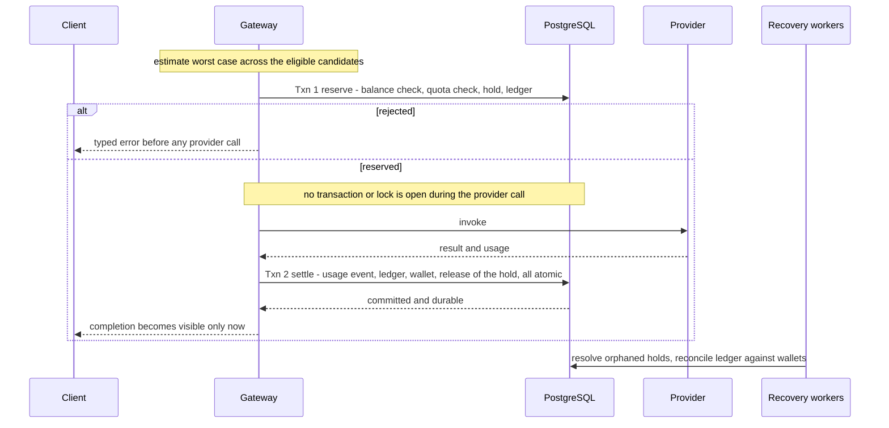

Three rules define this design:

1. **No DB transaction is open during a provider call.** Reservation is one short transaction; settlement is another. A stream that lasts a minute holds no DB connection and no row lock for that minute.
2. **Completion rule:** *usage and settlement are durable before the client can observe completion.* For non-streaming, the response body is not written until Txn 2 commits. For streaming, Txn 2 commits **before the usage chunk and the terminal `[DONE]`** are sent. Content chunks have already been delivered by then, but the client has not yet been told the response is complete; a stream that ends without `[DONE]` is, by contract, an incomplete response. The platform therefore never tells a client "success" for a response it has not recorded.
3. **Settlement runs on a context detached from the client request**, with its own short deadline, so a client disconnect cannot cancel the money write.

**Trade-off accepted:** one synchronous commit is added to the *tail* of every request (after the last content, before `[DONE]`). It does not affect TTFT or content streaming. Its size is measured in M0 (fsync spike) and reported in the benchmark (§3.2).

The background workers exist for **recovery and reconciliation only** — the request path is the primary settler.

### 15.3 Concurrency: racing for the last budget **[Confirmed scenario]**

Reservation is one atomic conditional operation on the wallet: it succeeds only if the available amount covers the estimate *inside the same statement*. Two concurrent requests serialize on the wallet row; exactly one succeeds and the other is refused before any provider call. No lock is held across I/O, and Redis is not involved.

**Ceiling (assumption, derived):** wallet-mutating transactions for one tenant serialize on one row, so the per-tenant rate is bounded by roughly the inverse of the commit latency. At a 2–5 ms commit and two transactions per request, that is on the order of a hundred-plus requests per second per tenant. M0 measures the real figure. The eval tenant at high concurrency is the likeliest hot spot (hence its own concurrency cap). **[Future]** escape hatch: sharded wallet buckets.

**Reservation sizing with fallback:** when a request is eligible for several candidates (auto or opted-in group), the hold is sized against the **most expensive eligible candidate**, so a fallback never needs a second reservation mid-flight. Cost: possible false refusals for tenants near zero balance.

### 15.4 Reservation lifecycle and recovery

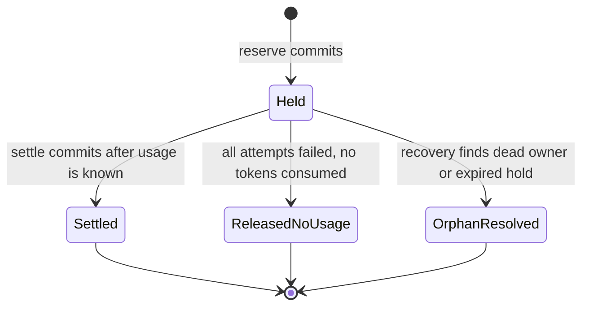

**Failure windows** (this table is what the crash tests in §19 assert):

| Window | State left behind | Client saw | Outcome |
|---|---|---|---|
| W1 crash before reserve commits | nothing | nothing | none |
| W2 crash after reserve, before or during the provider call | Held reservation | nothing, or a partial stream with no `[DONE]` | Orphan: resolved by recovery |
| W3 crash after provider returned, before settle commits | Held reservation, provider cost incurred | **no completion** (non-streaming: no body; streaming: content possibly seen, never `[DONE]`) | Orphan: resolved by recovery; client will retry; bounded **platform-absorbed** leakage, never an unrecorded successful completion |
| W4 settle committed, response lost in transit | Settled | maybe nothing | Customer billed for a response they may not have received; request ID in reports supports disputes; inference idempotency is **[Future]** |
| W5 settle cannot commit (database unavailable) | Held reservation | strict policy: error, no completion | §15.6 |

Compared with Draft 1's flush-then-persist ordering, the completion rule converts the worst case from *"customer received a completion that the platform failed to record"* into *"platform bore a bounded cost for an attempt the customer never saw complete"*, and that cost is observable.

**Recovery rules:**
- Reservations are tagged with the **owning gateway-instance epoch**. At boot, every hold from a previous epoch is an orphan and is resolved immediately; a hold from the live epoch is only considered after the maximum request deadline plus margin has passed, so a still-running stream's hold is never released early.
- **[Decided Q17] Orphan resolution policy:** release the hold and record **platform-absorbed leakage** — the customer cannot be billed for usage the platform has no evidence of, and exposure is bounded by the reservation. Track `orphaned_reservations_total` and estimated leakage.
- **Reconciliation:** periodic check that wallet balances equal the ledger-derived values; drift raises an alert.

### 15.5 Idempotency

Settlement and ledger writes are idempotent by `request_id`, so a retried settle (transient commit failure) or a recovery pass never double-charges. Client-side retries of inference produce new request IDs and are billable by design (documented, Q11).

### 15.6 Settlement failure at completion **[Decided: strict policy]**

If Txn 2 fails: bounded retry within a short deadline (on the detached context). If it still fails, the database is effectively down and the system is already failing closed. **Do not deliver completion if settlement cannot commit:** non-streaming returns a typed error; streaming emits an SSE `error` event instead of `[DONE]`. The hold is resolved by recovery under Q17; the customer is not charged. A **local durable journal** that would allow delivering completion and replaying usage later is **[Future]** if the strict policy proves too disruptive.

### 15.7 Invariants and bounded overspend **[Decided]**

Draft 1's "never overspend" was an over-claim: actual cost can exceed the reservation, because input tokens are *estimated* (no exact tokenizer is available for these providers in Go), reasoning tokens are billed but invisible in the output, and `max_tokens` semantics around reasoning differ by provider.

**Policy:**
1. The hold uses a **safety margin** on the input estimate and the clamped `max_tokens` for output. (The estimator itself is LLD; note that token count can never exceed payload byte count, which gives a provably conservative but loose upper bound.)
2. Settlement charges the **true cost**. If it exceeds the hold, the excess is written as a separate **overage** ledger entry and the wallet may go **briefly negative**.
3. **New reservations are refused while available balance is ≤ 0.**
4. **The overspend bound:** *per-request overage × the tenant's maximum concurrent in-flight requests.* The per-tenant concurrency cap (§16.4) is therefore also a financial control.
5. Overage rate is a metric with an alert threshold; persistent overage means the estimator needs tuning.

**Invariants (asserted by tests):**
1. Reserved + spent never exceeds deposited **except by recorded overage entries**, and total overage stays within the bound above.
2. The ledger is append-only.
3. Wallet figures equal ledger-derived values (reconciliation).
4. Every request settles at most once.
5. A completion is visible to a client only after its settlement committed.
6. Every hold ends in exactly one terminal state (§15.4).
7. Eval-channel usage never appears in customer billing reports.

### 15.8 Token accounting edge cases **[Decided Q5]**

When a stream breaks, or the client disconnects mid-stream, the provider's final usage may never arrive: **estimate partial usage locally and mark it `usage_source=estimated`**, settle it in Txn 2 on the detached context, and review estimates periodically against provider dashboards. Forcing upstream usage reporting (§10.3) keeps this the exception.

### 15.9 Token controls: TPM limiter vs period quota **[Decided]**

| Control | Nature | Where it lives | Rejection |
|---|---|---|---|
| **TPM limiter** | Ephemeral, short window, protects against bursts | Redis counters, in-process fallback | typed `tpm_limit` |
| **Period token quota** | Durable, per day/month, derived from real usage | Counters co-located with wallet state, **checked inside the reservation transaction** | typed `token_quota_exceeded` |

**LLD note:** per-key quotas and budget shares touch a second row inside the same reservation transaction; the LLD must define a lock-ordering rule to avoid deadlocks.

### 15.10 Data growth and retention **[Recommendation]**

Per request the system writes one usage event and a small constant number of ledger rows. *Assumption:* on the order of 1–2 KB per request including indexes, so a million requests is on the order of a couple of GB. Therefore:
- `usage_events` and ledger are **time-partitioned from the start** (pulled forward from Future).
- Reports read **rollup tables**, never raw usage scans.
- Raw usage events have a configurable retention window. The ledger is immutable: it is archived to cold backups, never edited or deleted in place.
- The retention window itself is an owner decision.

---

## 16. Inference and streaming request flows

### 16.1 Admission order

The cheapest rejection happens first: pre-auth source limiter → key format check → authentication (L1) → rate and TPM limits → **per-tenant/per-key concurrency admission** → guardrails → routing → reservation → provider call → settlement → completion.

### 16.2 Non-streaming request

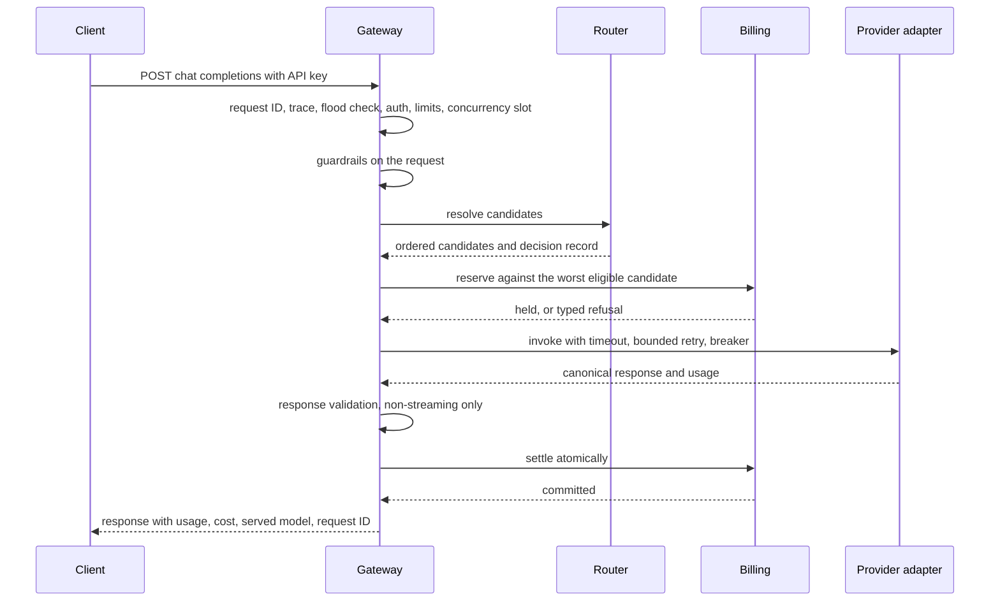

### 16.3 Streaming request and the commit point

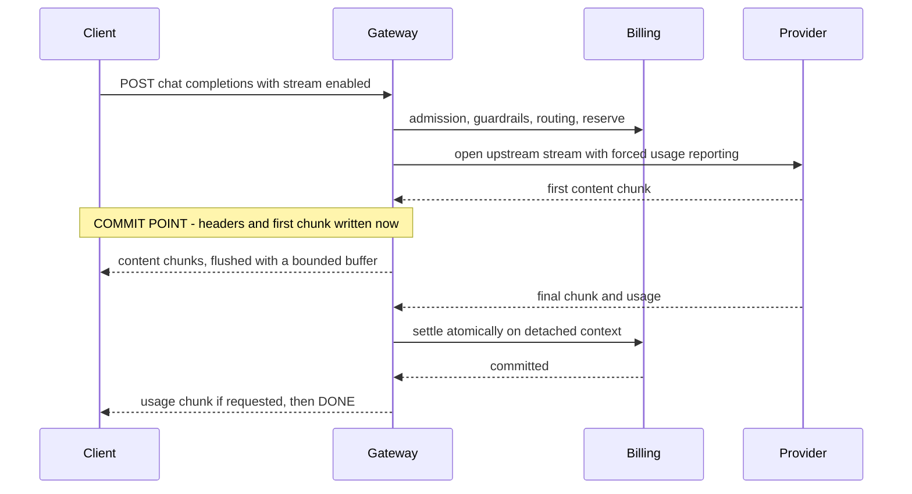

**Commit point** **[Recommendation, key decision]**: the first *content* chunk written to the client. **Response headers are not flushed before it**, otherwise the `200` itself would be a commit and a pre-commit failure could no longer return a real error status.

- **Before commit:** retries are allowed; fallback only along an opted-in group; failures return proper typed errors.
- **After commit:** no provider switch, ever. The response identity is already observable and switching would yield an inconsistent or duplicated answer. A failure emits a well-formed SSE `error` event, partial usage is settled (estimated if needed), and `degraded_stream` is counted.
- **Client disconnect:** request context cancels → upstream call aborted → partial usage estimated → settled on the detached context → no `[DONE]` is written to a dead connection.
- **Slow client:** a bounded write buffer; after a grace window the connection is evicted (`slow_client_evictions_total`).
- **TTFT** = admission, guardrails, routing, reservation commit, plus provider TTFT.

### 16.4 Concurrency, fairness and backpressure **[Decided: per-tenant concurrency fairness]**

Shared global and per-provider semaphores alone let one tenant's long streams starve everyone. Therefore:

- **Per-tenant and per-key maximum in-flight** requests (streams included), with the eval tenant on a deliberately small cap.
- **Fair-share under saturation:** when global or provider capacity is exhausted, admission favours tenants below their fair share over those already consuming more.
- **Typed, distinguishable rejections:** `tenant_concurrency_limit` (your limit) vs `platform_overloaded` (shedding), both with `Retry-After`. Never unbounded queueing.
- As noted in §15.7, the per-tenant cap also bounds worst-case overspend.

---

## 17. Evaluation workflow

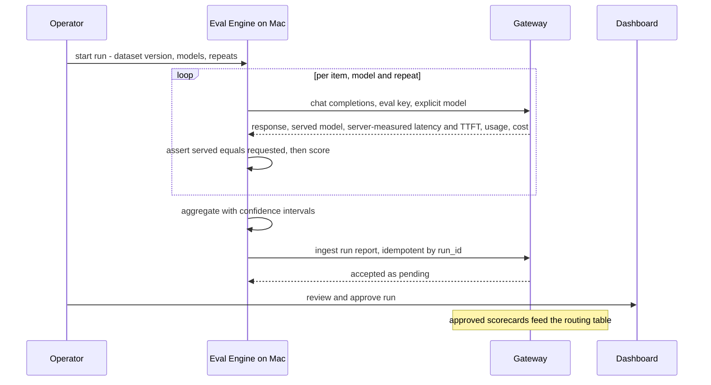

1. **Select matrix** — datasets × explicit models × repeats.
2. **Execute** from the Mac through the gateway under the eval identity. Limits, concurrency caps and the run spend cap apply; the run aborts cleanly at the cap and is resumable.
3. **Validate** — any response whose served model differs from the requested one is discarded and counted.
4. **Score** per dataset type; normalize to 0–1.
5. **Report** with intervals, server-reported latency and cost per correct answer.
6. **Ingest** — pending until approved.
7. **Consume** — approved scorecards feed routing (§12).

---

## 18. Observability architecture

### 18.1 Metrics (Prometheus) — covers F46

| Group | Metrics |
|---|---|
| Traffic | `http_requests_total{route,status,channel}`, `http_request_duration_seconds` |
| Overhead | `gateway_pre_provider_seconds`, `gateway_completion_tail_seconds` (settle commit), `ttft_seconds`, `admission_wait_seconds` |
| Providers | `provider_request_duration_seconds{provider,model}`, `provider_errors_total{provider,class}`, `provider_429_total{provider}`, `circuit_state{provider,model}`, `provider_probe_total` |
| Streaming | `active_streams`, `stream_duration_seconds`, `client_disconnects_total`, `slow_client_evictions_total`, `degraded_streams_total` |
| Routing | `routing_decisions_total{reason}`, `fallback_total{from,to,reason}`, `eval_evidence_used_total` |
| Money | `tokens_total{direction,model,channel}`, `request_cost_microusd`, `reservations_total{outcome}`, `settle_failures_total`, `orphaned_reservations_total`, `platform_leakage_microusd`, `overage_microusd`, `ledger_reconcile_drift` |
| Limits | `rate_limit_rejections_total{scope}`, `concurrency_rejections_total{kind}`, `auth_rejections_total{reason}`, `budget_rejections_total`, `guardrail_denials_total{rule,tier}` |
| Resources | Go runtime/process metrics, Postgres and Redis exporters, container memory, **CPU steal** |

**Cardinality discipline:** `tenant` is not a label on high-cardinality histograms; per-tenant numbers come from usage rollups. Prometheus uses a modest scrape interval and short retention to protect memory and disk.

### 18.2 Tracing (OpenTelemetry)

One trace per request: `gateway.request` → `auth`, `limits`, `guardrails`, `route`, `budget.reserve`, `provider.call` (attempts as events with reason), `stream.pump`, `budget.settle`. Trace and request IDs are returned in response headers.

**[Decided Q9] Tracing on the VPS is disabled by default; full tracing is available locally during development.** The SDK always instruments; the exporter is configurable: full OTLP to a local Jaeger on the MacBook during development and load tests; on the VPS the exporter is off by default (heavily sampled short-retention export is an option if ever needed). No OTel Collector process is deployed. Tracing is a debugging tool here, not a compliance requirement.

### 18.3 Logging (slog)

- JSON to stdout with Docker log rotation (size and file-count caps). Every line carries `request_id`, `trace_id`, `tenant_id`, `key_id`, `model`, `provider`.
- Structural redaction of auth headers, keys and provider secrets. Prompt/response content is logged as **length and hash only**.
- **Success-line sampling under load** is allowed so logging cannot dominate disk during load tests; errors and fallbacks are never sampled.

### 18.4 Grafana dashboards

1. Gateway overview. 2. Provider health. 3. Tenants and money (spend rate, overage, leakage, reservations). 4. Routing. 5. VPS resources (memory, CPU **steal**, disk I/O per container).

---

## 19. Performance and failure-testing strategy

### 19.1 Load testing (heavy runs from the MacBook)

**Methodology rules:**
- Use **open-model** load (arrival-rate executors), not closed virtual-user loops — closed loops hide tail latency through coordinated omission.
- k6 does not natively give clean SSE time-to-first-token; T4 needs an SSE-capable extension or a small purpose-built Go streaming load generator.
- **Gateway overhead is taken from in-process phase histograms**, cross-checked against k6, rather than relying only on subtracting a direct-to-mock baseline (which contains network and scheduling noise).
- Short, rate-capped runs only against the VPS (it hosts other apps); the VPS numbers are labelled *indicative* because Contabo storage and CPU steal vary.

| ID | Scenario | Success criteria |
|---|---|---|
| T1 | Gateway overhead against a fixed-latency mock | Pre-provider and completion-tail overhead reported; targets set after M0 |
| T2 | Per-feature overhead delta (auth, limits, policy, reserve, settle) | Each feature's cost quantified |
| T3 | Direct-to-mock baseline | Cross-check for T1 |
| T4 | Concurrent SSE streams ramped to saturation | Saturation point documented; flat memory; no goroutine leak; bounded TTFT overhead |
| T5 | Soak (30–60 min) | Stable RSS; no ledger drift; no leaked reservations |
| T6 | **Budget race**: many concurrent requests against a budget for fewer | Exactly the affordable number succeed; **overspend ≤ documented bound** |
| T7 | Rate and TPM limiter correctness under burst | Counts within tolerance |
| T8 | Resource envelope of the full stack | Memory, CPU, disk against the shared 8 GB budget |
| T9 | **Key-flood attack** (random and unknown keys) | Database query rate stays flat; legitimate traffic unaffected |
| T10 | **Tenant fairness**: one tenant saturates its concurrency | Other tenants' latency and success rate unaffected |

### 19.2 Fault injection matrix (Toxiproxy + mock fault modes)

| ID | Fault | Expected behaviour (asserted) |
|---|---|---|
| FI-1 | Provider timeout | Bounded retry; fallback **only** with opted-in group; typed error otherwise |
| FI-2 | Provider 429 storm | `Retry-After` honoured; no retry storm; breaker reacts |
| FI-3 | Provider outage | Fast typed failure for explicit-only traffic; failover for opted-in groups; health view reflects it |
| FI-4 | Mid-stream provider drop | SSE `error`; partial usage settled as estimated; no hang |
| FI-5 | Client disconnect mid-stream | Upstream aborted promptly; settlement completes on detached context; no goroutine or connection leak |
| FI-6 | Redis down | In-process limiter fallback; no money impact; alert |
| FI-7 | PostgreSQL down | New inference refused; in-flight requests follow Q16 strict policy; ledger intact on recovery |
| FI-8 | Gateway SIGTERM under load | Drain: stop accepting, finish in-flight within grace, settle, exit |
| FI-9 | **kill -9 after reserve, before provider** (W2) | Orphan resolved at boot; invariants hold |
| FI-10 | **kill -9 after provider returns, before settle commits** (W3) | **Client received no completion**; hold resolved; leakage metric increments |
| FI-11 | Concurrent reserve/settle storms with random crashes | Invariants 1–7 hold; overspend within bound |
| FI-12 | Slow client read stall | Bounded buffers; eviction; flat memory |
| FI-13 | **Keep-alive without content progress** | Progress-based timeout fires; breaker uses TTFT signal |
| FI-14 | Settle commit failure injected (Toxiproxy on the DB) | Strict policy: no completion, typed error or SSE error, no double charge |

Every test asserts on **observable behaviour** — status, SSE event, metric delta, ledger invariant — not merely "did not crash".

---

## 20. Reliability and failure handling

### 20.1 Degradation modes

| Dependency lost | Data plane behaviour | Rationale |
|---|---|---|
| **Redis** | Rate/TPM limiting falls back to conservative in-process limiters; caches are already L1 so reads continue; traffic continues | Limiting is protective, not financial; single instance makes local state acceptable |
| **PostgreSQL** | **Fail closed**: new inference refused with `503` + `Retry-After`; in-flight requests follow the strict settlement policy (§15.6) | Cannot enforce budgets or record usage |
| **A provider** | Circuit isolates it. Explicit-model traffic without a group fails fast with a typed error; opted-in groups and auto traffic shift to other candidates | Substitution requires consent |
| **All providers** | Fast typed `503`; no queue build-up | Bounded failure beats latency collapse |
| **Redis + PostgreSQL** | Fail closed | No safe degraded mode |
| **Prometheus, Grafana, tracing** | No traffic impact | Out of the request path |
| **Eval engine** | No impact | Independent, runs elsewhere |

### 20.2 Provider reliability mechanics

- **Timeouts keyed to content progress** **[Decided direction, verify]**: a total request deadline, connect timeout, **TTFT timeout** and an **inter-content-chunk idle timeout** that counts only content, not SSE comments or keep-alive lines (some providers hold connections open under load instead of rejecting).
- **Retries:** bounded (≤2 attempts per provider), exponential backoff with jitter, only for transient/throttled classes and only before commit. Failed attempts are not billed to the tenant; they are tracked as platform leakage.
- **Circuit breakers** per provider × model: error-rate **and TTFT/latency** thresholds over a sliding window; state in-process with metric export; shared state is **[Future]**.
- **Passive-first health [Decided]:** health is derived from live traffic — error rates, 429 rates, TTFT, breaker state.
- **Active probes only for recovery [Decided Q20]:** a **minimal, spend-capped probe** for half-open circuit recovery and long-idle provider checks (tiny `max_tokens`, long intervals, probe-spend cap). **No continuous probing** — LLM endpoints have no free health call, and probing consumes provider quota and money. Customer requests are never used as half-open test subjects.
- **Concurrency and backpressure:** per-tenant, per-provider and global limits with fair-share (§16.4).

### 20.3 Mid-stream semantics

See §16.3: commit point = first content chunk; after it, honest SSE error plus settled partial usage; never a provider switch.

### 20.4 Failure-aware money handling

Every failure path ends every hold in exactly one terminal state (§15.4). Failed attempts before any provider consumption release the hold with zero charge.

### 20.5 Shutdown and deploys **[Recommendation]**

A single instance means a deploy interrupts service. Mitigation: on SIGTERM stop accepting new requests, let in-flight requests finish up to a grace period (settling normally), then cancel the rest, settle partial usage and exit. Boot-time recovery resolves anything left (§15.4). This is an accepted limitation, not an availability claim.

---

## 21. Deployment architecture (target shared VPS — **not yet purchased**)

The 8 GB RAM / 4 vCPU / 100 GB SSD figures are **target specifications**, not existing infrastructure. Proxy-specific and host-specific decisions are **deferred until provisioning**; the architecture below describes the target topology.

### 21.1 Topology **[Decided: shared reverse proxy, static dashboard]**

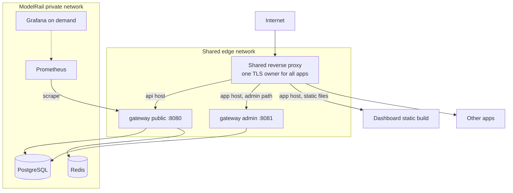

- **One shared reverse proxy for all applications on the VPS.** ModelRail supplies its site definitions as config that drops into the shared proxy; it **does not claim ports 80/443**. **[Decided]** The proxy **software choice is open until provisioning** (§21 notes the required routing behaviour, not a product); the same host/path routing is expressed in whichever proxy is chosen then. PostgreSQL and Redis stay on a private network; the dashboard stays a static build.
- ModelRail attaches its gateway to a shared **edge network** with the proxy. PostgreSQL, Redis and Prometheus sit on a **private network** with no published ports.
- The dashboard is a static export copied to a directory the proxy serves — no container, no Node process.

### 21.2 Service budget **[Assumption — validated by T8]**

| Service | Profile | Memory (est.) | Notes |
|---|---|---|---|
| Gateway (Go) | core | ~120–180 MB | `GOMEMLIMIT` set; bounded buffers |
| PostgreSQL | core | ~250–350 MB | Small `shared_buffers`, ~40 connections max; **dedicated instance** for ledger blast-radius and restore |
| Redis | core | ~64–100 MB | `maxmemory` set; TTL on all keys; **dedicated instance** |
| Prometheus | core | ~150–200 MB | Modest scrape interval, short retention |
| Grafana | on demand | ~150 MB | Started when investigating |
| Dashboard | — | 0 | Static files |
| Eval engine, k6, mock, Toxiproxy | — | 0 on the VPS | Run on the MacBook |

**Estimated steady state: roughly 0.7–1.0 GB**, leaving the majority of the 8 GB to the other applications. Every container has a **memory limit**.

### 21.3 Shared-host realities **[Recommendation]**

| Risk | Response |
|---|---|
| **Storage fsync variance** — both the reserve and settle commits depend on it | **M0 spike on the provisioned VPS:** measure fsync latency and commit P99 before any numeric overhead target is set |
| **CPU steal / noisy neighbours** | Track steal in the resource dashboard; publish headline benchmarks from the Mac; label VPS numbers indicative |
| **OOM killer takes out PostgreSQL when another app spikes** | Container memory limits, `GOMEMLIMIT`, small swap, process priority favouring PostgreSQL, OOM-event alert |
| **Load tests hurt neighbours** | Heavy tests local only; short capped runs on the VPS |
| **Exposure on a shared host** | Firewall allow-list (SSH, HTTP, HTTPS), key-only SSH, no published DB/Redis ports, separate Docker networks per app |

### 21.4 Operations

- **Backups [Decided Q21]:** **daily off-VPS backup** (`pg_dump` shipped to object storage) plus a **pre-deployment dump** and a documented **restore drill**; MVP target **24-hour RPO**. A provider snapshot on the same host is not a backup. Continuous WAL archiving is **[Future]**.
- Config via environment plus mounted config; secrets via file with restrictive permissions; no secrets in images.
- Docker log rotation; Prometheus retention caps; disk alert at 70%.
- One deploy script: build, migrate, switch. Migrations are forward-only and backward-compatible for one release so a rollback is "previous image".
- The dashboard build is deployed by copying files; the admin listener is only reachable through the proxy's authenticated admin route.

---

## 22. Resource and cost considerations

### 22.1 Cost

| Item | Strategy |
|---|---|
| **LLM budget (~$5)** | Eval runs and manual experiments only; small datasets; repeats sized to the budget; per-run cap enforced by the eval wallet; a cost ledger in every eval report; free-tier keys for evals only; load tests never touch real providers |
| **VPS memory/CPU** | §21.2–21.3; on-demand Grafana; Mac-side eval and load generation |
| **Disk** | Partitioned usage tables with retention; Prometheus retention; log rotation; off-box backups |
| **Egress** | Streaming responses are the main egress |
| **Engineering effort** | Modular monolith, one VPS, milestone plan (§23) |

### 22.2 Capacity envelope **[Assumption-labelled, validated by T4/T5/T8]**

| Dimension | Back-of-envelope | Consequence |
|---|---|---|
| Memory per active stream | Tens of KB: a goroutine, HTTP connection buffers, a bounded write buffer, an upstream connection | Thousands of concurrent streams fit in tens of MB; file descriptors (two sockets per stream) and provider concurrency limits bind first, so set `ulimit` and provider semaphores deliberately |
| DB connections | Used only during two short transactions per request, **not** during provider calls | A small pool (≈20–30) serves many concurrent streams; pool wait becomes a backpressure signal |
| Commits | Two synchronous commits per request | Throughput is bounded by commit latency; group commit helps across tenants, not within one wallet row (§15.3) |
| Logs | Roughly a line per request of ~1 KB | Hundreds of GB/day at sustained load-test rates, hence rotation caps and success-line sampling |
| Usage/ledger growth | ~1–2 KB per request including indexes | Partitioning and retention (§15.10) |

---

## 23. Milestones, MVP and future

### 23.1 Milestone plan **[Decided: reduce MVP scope into milestones]**

Ordering principle: **build depth where the differentiators are (ledger, reliability) before breadth (providers, UI, eval).**

| M | Deliverable | Exit criteria |
|---|---|---|
| **M0** | **Day-0 spikes on the VPS**: fsync/commit latency; memory baseline of the other apps; decide the shared proxy; verify provider-behaviour claims (DeepSeek keep-alive and usage options, reasoning-token billing, Gemini token accounting); Mac↔VPS round-trip time | Numbers and a short findings note recorded; overhead targets set; Q14b closed |
| **M1** | **Vertical slice**: Mock + DeepSeek adapters; keys and tenants (seed/admin CLI); unary + streaming; slog, request IDs, Prometheus metrics; first deploy to the VPS with off-box backups | OpenAI SDK works against mock and DeepSeek; logs and metrics visible |
| **M2** | **Ledger**: pricing versions, reserve → serve → atomic settle with the completion rule, recovery, reconciliation, overage handling, backup restore drill | T6 passes; FI-9, FI-10, FI-11 pass; invariants hold under randomized crash + concurrency |
| **M3** | **Reliability**: progress-based timeouts, bounded retry, breakers, passive health, 429 handling, backpressure, disconnect handling, drain on SIGTERM, fault matrix against mock + Toxiproxy | FI-1…FI-8, FI-12…FI-14 pass as automated assertions |
| **M4** | **Isolation**: rate + TPM limits, period quota, per-tenant concurrency and fair-share, key-flood protection, essential guardrails, Redis degradation | T7, T9, T10 pass |
| **M5** | **Breadth**: Gemini adapter, model registry, opt-in fallback groups, automatic routing (constraint pipeline), served-model/routing metadata | Scenarios S3 and S14 pass; explicit-model contract verified |
| **M6** | **Dashboard** (static export): tenants, keys, budgets, usage, providers/models, health, operator auth, audit log | Operator can run the system without a CLI |
| **M7** | **Evaluation**: Python engine on the Mac, datasets, deterministic scorers, confidence intervals, model-version tracking, ingest + approval, routing integration. *Stretch:* sandboxed code-exec scorer (Mac only), auto-routing eval mode, budget-gated LLM judge | Approved scorecards change routing decisions with recorded evidence; low-evidence cases fall through |
| **M8** | **Performance and write-up**: T1–T10 results, Grafana dashboards, published benchmark note, VPS reality-check run | Reproducible benchmarks published with methodology and caveats |

**Cut or deferred first if schedule slips:** optional guardrail tier, code-exec scorer, LLM judge, tracing on the VPS, structural task-class heuristics.

### 23.2 Deferred **[Future]**

- Customer-facing portal with `tenant_admin`; OIDC/SSO; self-service signup; payments/invoicing.
- Semantic or response caching; embeddings/Responses API/images; WebSocket streaming.
- Multi-instance gateway (shared breaker state, Redis-coordinated limits), managed Postgres, real SLOs, WAL archiving.
- Weighted/adaptive routing, bandits, canary rollouts, A/B splits.
- Advanced guardrails (ML injection detection, moderation models), buffered-stream default.
- Row-level security, tenant data export/deletion, BYOK provider keys.
- Local durable journal for settlement failure (§15.6b); inference idempotency keys; sharded wallet buckets.
- Long-term log/trace stores (Loki/Tempo).

---

## 24. Architecture Decision Records

### ADR-01 — Modular monolith
**Decision:** one Go binary with enforced module boundaries (§8); separate Python evaluator and static frontend. **Rejected:** microservices (no scale benefit, high operating cost), unstructured monolith (boundaries decay). **Consequences:** simple transactions and deploys; seams preserved at the adapter and admin API.

### ADR-02 — PostgreSQL is the only financial truth; Redis is ephemeral
**Decision:** wallet and ledger live only in PostgreSQL; Redis holds rate/TPM counters and invalidation signalling. **Rejected:** Redis balances (durability and audit), dual-write (split-brain). **Consequences:** two short DB transactions per request, bounded and measured.

### ADR-03 — Reserve, settle atomically inline, completion rule *(revised, owner-amended)*
**Decision:** reserve a worst-case hold; never hold a transaction across a provider call; on provider completion persist usage event, ledger and wallet changes in **one atomic transaction before the client observes completion** (before `[DONE]` for streams); workers do recovery and reconciliation only. **Rejected:** async routine settlement — it inflates `reserved` balances, causes false refusals, adds a second writer on the hot row and leaves a window where a completion is delivered but unrecorded; settle-after-flush for the same reason; a transaction spanning the provider call — it pins connections and locks for the whole stream. **Consequences:** one added commit at the tail of every request (measured in M0/T1); unrecorded provider cost reduced to a bounded, observable, platform-borne orphan case (§15.4).

### ADR-04 — No message broker; in-process recovery workers
**Decision:** recovery, reconciliation, rollups and routing-table rebuilds run in-process. **Rejected:** RabbitMQ/Kafka (no fan-out or throughput need; violates constraints). **Consequences:** fewer services; jobs are tied to the gateway lifecycle and must be idempotent.

### ADR-05 — OpenAI wire surface, canonical internal schema
**Decision:** clients speak OpenAI; adapters map provider dialects to one canonical model including usage with reasoning tokens. **Consequences:** provider changes are localized; usage normalized once.

### ADR-06 — Streaming commit point at first content chunk
**Decision:** no provider switch after the first content chunk; headers are withheld until then; later failures surface as SSE errors with settled partial usage. **Rejected:** silent mid-stream switching (inconsistent, dishonest), buffering the full response (kills TTFT).

### ADR-07 — Fail closed on PostgreSQL, degrade on Redis
**Decision:** database loss refuses new inference; Redis loss falls back to in-process limiting. **Rejected:** fail-open without budget enforcement (unbounded spend).

### ADR-08 — Deterministic constraint-pipeline routing, evidence-gated
**Decision:** filters for allowlists, capability, health and (where valid evidence exists) a quality floor, then lowest cost with a latency ceiling; no LLM in the path. **Rejected (for now):** weighted score — needs tuning data the project will not have. **Consequences:** explainable, testable, zero routing cost.

### ADR-09 — Evaluation as a separate workflow on the MacBook
**Decision:** on-demand Python evaluator off the VPS, HTTP-only, eval identity with server-enforced no-fallback, restricted ingest endpoint, operator approval before routing influence. **Rejected:** evaluator on the VPS (memory, code-execution risk on a shared host), direct DB writes (boundary violation), per-request evaluation (cost, latency). **Consequences:** clean separation; server-reported latency required for valid measurements.

### ADR-10 — Peppered keyed hash for API keys with versioned pepper
**Decision:** keyed fast hash, constant-time compare, `pepper_version` for rotation. **Rejected:** password KDF (latency on every request, no benefit for high-entropy secrets).

### ADR-11 — Observability footprint
**Decision:** Prometheus on the VPS, Grafana on demand, OTel instrumentation always with exporter off or sampled on the VPS and no collector there. **Rejected:** full stack on the VPS (memory), none (contradicts requirements).

### ADR-12 — Prompt content not stored by default
**Decision:** metadata, counts and hashes only. **Consequences:** simpler privacy story, less forensic visibility.

### ADR-13 — Fallback is opt-in and consented *(new)*
**Decision:** explicit model means that model; substitution only along tenant-defined fallback groups subject to the provider allowlist; evals never fall back; every response reports the served model. **Rejected:** default fallback — silently changes quality, price, context limits and data-processing vendor, and invalidates evaluation results.

### ADR-14 — Bounded overspend, not zero overspend *(new)*
**Decision:** hold with a safety margin, settle true cost, record excess as an overage ledger entry, allow a bounded negative balance, refuse new reservations at ≤0; the bound is per-request overage × per-tenant concurrency cap. **Rejected:** claiming zero overspend (estimation error and reasoning tokens make it false); refusing to settle true cost (hides real spend).

### ADR-15 — Shared reverse proxy and static dashboard *(new)*
**Decision:** one proxy owns TLS for the VPS; dashboard is a static export served from disk; admin API reached via a same-origin proxied path. **Rejected:** a ModelRail-owned proxy on 80/443 (conflicts with the other apps), a Node SSR container (100–300 MB for no benefit). **Consequences:** no Next.js server features; cookie-authenticated SPA.

### ADR-16 — Passive-first provider health *(new)*
**Decision:** derive health from live traffic; probe only for half-open recovery and idle checks with a spend cap. **Rejected:** continuous active probing (costs money and provider quota).

### Trade-off summary

| Decision | We gain | We pay |
|---|---|---|
| Inline atomic settlement with completion rule | No unrecorded delivered completion; no `reserved` lag | One extra commit at request tail; strict failure behaviour when the DB is down |
| Bounded overspend | Honest guarantee, true cost recorded | Possible small negative balances |
| Opt-in fallback | Contract honesty, valid evals | Fewer automatic rescues |
| Evaluator on the Mac | No VPS cost or sandbox risk | Network-noisy client timing (solved via server metrics); Mac must be online |
| Static dashboard | No runtime on the VPS | No SSR; cookie-auth SPA |
| Single VPS instance | Simplicity and low cost | Deploys are outages; no availability claim |

---

## 25. Workflow scenarios

### S1. Normal inference request (explicit model)
1. Request reaches the shared proxy, then the public listener.
2. Flood check, authentication from L1, rate/TPM limits, per-tenant concurrency slot.
3. Guardrails: payload, permissions, clamps, tool restrictions.
4. Router validates the model against registry, tenant allowlists and capabilities; health check on the circuit.
5. **Txn 1** reserves the hold (or a typed refusal, before any provider spend).
6. Adapter calls the provider under a progress-aware timeout; response normalized; non-streaming validation runs.
7. **Txn 2** commits usage event, ledger, wallet and hold release atomically.
8. Only then is the response written, including usage, cost, served model and request ID.

### S2. Explicit model not allowed
Authorization denies with a typed `model_not_allowed` before routing, reservation or provider call. No cost.

### S3. Automatic model routing
1. `model: "auto"` → candidates are all models allowed for the tenant and key.
2. Filters: allowlist → capability → passive health → quality floor *only where approved, fresh, sufficiently large evidence exists*.
3. Lowest cost wins within the latency ceiling; stable tie-break; reason codes recorded (`no_eval_evidence` if the quality stage was skipped).
4. The hold is sized against the most expensive eligible candidate. The response reports the served model and routing reason.

### S4. Streaming request
1. As S1 through reservation; the upstream stream is opened with usage reporting forced on.
2. Nothing, including headers, is written until the **first content chunk** arrives — the commit point.
3. Chunks are flushed through a bounded buffer; `active_streams` is tracked.
4. When the provider's final usage arrives, **Txn 2 commits on a detached context**; then the usage chunk (if the client requested it) and `[DONE]` are sent.
5. Failure before commit → retry or opted-in fallback; failure after commit → SSE `error`, partial usage settled as estimated.

### S5. Provider returns HTTP 429
1. The adapter classifies `throttled` and reads `Retry-After`.
2. **Explicit model, no group:** if the remaining deadline allows, back off and retry the *same* provider; otherwise return a typed 429 `provider_throttled` with `Retry-After`.
3. **Opted-in group or auto:** after bounded retry, move to the next candidate pre-commit.
4. The breaker tracks throttling; `provider_429_total` increments; the failed attempt is not billed (tracked as leakage). The hold, sized for the worst eligible candidate, covers whichever candidate finally serves.

### S6. Provider becomes unavailable
1. Passive signals (errors, TTFT) open the circuit for that provider × model.
2. The router excludes it immediately. Explicit-only traffic gets a fast typed error; group/auto traffic shifts to other candidates.
3. A minimal probe tests recovery while the circuit is half-open; flapping is bounded by breaker timing.
4. If every candidate is down: fast `503 provider_unavailable`, no queue build-up, alerts fire.

### S7. Two concurrent requests race for the remaining budget
1. Both estimate cost X; the wallet can cover only one.
2. Both attempt the atomic conditional reservation; the row serializes them. One commits; the other is refused with a typed error **before any provider call**.
3. The winner's actual cost may differ from X; any excess is an **overage** entry and the balance may dip briefly below zero, after which new reservations are refused. Total overage is bounded by per-request overage × the tenant's concurrency cap. Asserted in T6/FI-11.

### S8. Customer reaches a rate limit
1. The limiter rejects with a typed `rate_limited` (or `tpm_limit`) and `Retry-After` — before concurrency admission, guardrails, routing or reservation.
2. Per-key and per-tenant limits are independent; the eval tenant has its own, so an eval burst cannot starve customers.
3. Redis down → conservative in-process limiters.

### S9. Python starts an evaluation run
1. The operator starts the engine **on the MacBook** with datasets × explicit models × repeats.
2. It authenticates with the eval key (`inference` + `eval:submit` only); the eval wallet cap and limits apply.
3. Requests flow through the real pipeline; **fallback is disabled by gateway policy**; the engine records server-measured latency and discards any response whose served model differs from the requested one.
4. Per-item checkpointing; clean abort at the spend cap; resumable.

### S10. Python submits evaluation results
1. The engine aggregates scores with confidence intervals and model-version metadata.
2. It posts the report to the **ingest endpoint** on the public listener, idempotent on `run_id`.
3. The run is stored **pending** and inert; eval-channel spend stays out of customer reports.
4. The operator reviews and approves it in the dashboard.

### S11. Go uses evaluation results in routing
1. Approval triggers a routing-table rebuild as version N+1; snapshots refresh within seconds.
2. A scorecard influences selection only if fresh, above the minimum sample size, and the candidate gap exceeds the confidence-interval overlap.
3. Decisions record `policy_version` and reason codes; weak or missing evidence records `no_eval_evidence` and falls through to cost/latency.
4. Rollback reverts to version N — a data change, no deploy.

### S12. Redis or PostgreSQL becomes unavailable
- **Redis:** traffic continues; in-process limiters take over; key and config reads are already L1; alert raised; no money impact.
- **PostgreSQL:** new inference is refused with `503` + `Retry-After`. Requests already running when it fails cannot commit Txn 2; after bounded retry they follow the **strict policy** — no completion delivered, typed error or SSE `error`. Their holds become orphans resolved by recovery under Q17(a). On recovery, reconciliation verifies the ledger; no double charges, and no completion was ever delivered unrecorded.

### S13. Customer disconnects during streaming
1. The request context cancels; the pump stops and the upstream call is aborted.
2. Partial usage is estimated (`usage_source=estimated`) and **settled on a detached context**; nothing is written to the dead connection.
3. `client_disconnects_total` increments; no goroutine, connection or hold is leaked (FI-5).

### S14. Explicit model with an opted-in fallback group
1. The tenant policy declares `deepseek-chat → gemini-flash` as a fallback group; the provider allowlist permits both vendors.
2. DeepSeek times out before the first content chunk; the retry budget is exhausted.
3. The pipeline moves to the next group member pre-commit; the hold already covers the more expensive of the two.
4. The response reports `served_model = gemini-flash`, the reason code `fallback_provider_timeout`, and usage priced against the model that actually served.
5. The same request from the **eval tenant** would instead return a typed error — fallback is forbidden there.

### S15. Gateway crash or restart
1. A kill after reserve or after the provider call leaves a **Held** reservation tagged with the dead epoch (windows W2/W3).
2. On boot, recovery resolves every previous-epoch hold immediately, per Q17(a): release plus platform-absorbed leakage metric.
3. No client received a completion that is missing from the ledger; reconciliation confirms the wallet matches the ledger.
4. A graceful SIGTERM follows the drain path (§20.5) instead and normally leaves no orphans.

---

## 26. Decision register (resolved open questions)

| # | Question | Status | Decision |
|---|---|---|---|
| Q1 | Dashboard audience and auth | **Decided** | Operator-only, `platform_admin` in MVP; customer-facing portal deferred **[Future]** |
| Q2 | Tenant onboarding | **Decided** | Operator-created |
| Q3 | Task-class signal | **Decided** | Explicit `modelrail-task` hint; default `general`; structural heuristics deferred until evaluation evidence |
| Q4 | Gemini adapter | **Decided** | Native provider adapter, implementation in M5 |
| Q5 | Broken-stream token accounting | **Decided** | Estimate partial usage, `usage_source=estimated`; force upstream usage reporting |
| Q6 | Code-execution scorer | **Decided** | Mac-only stretch goal in M7 |
| Q7 | LLM-as-judge | **Decided** | Disabled by default; budget-gated **[Future]** feature |
| Q8 | Key revocation latency | **Decided** | Immediate for new requests in the single gateway instance; existing requests may finish |
| Q9 | Tracing on the VPS | **Decided** | Disabled by default on the VPS; full tracing available locally during development |
| Q10 | Currency precision | **Decided** | Integer micro-dollars |
| Q11 | Inference idempotency | **Decided** | Deferred; client retries create separately billable requests |
| Q12 | Response caching | **Decided** | Not included in MVP |
| Q13 | Explicit-model fallback | **Decided** | Opt-in tenant-defined fallback groups; requests may narrow, never widen, the group; provider allowlist and consent mandatory; evaluation traffic never falls back |
| Q14 | Shared reverse proxy | **Decided** | One shared proxy for all apps; software choice open until provisioning; ports 80/443 not claimed; Postgres/Redis private; dashboard static |
| Q15 | Overspend policy | **Decided** | Bounded overspend; actual cost settled and excess recorded (§15.7) |
| Q16 | Settlement failure at completion | **Decided** | Strict policy: do not deliver completion if settlement cannot commit; local journal **[Future]** |
| Q17 | Orphaned reservation resolution | **Decided** | Release the hold and record platform-absorbed leakage |
| Q18 | Routing selection strategy | **Decided** | Deterministic constraint pipeline, not weighted scoring |
| Q19 | Billing for validation-rejected output | **Decided** | Charge incurred provider cost; typed error; no automatic retry |
| Q20 | Half-open recovery mechanism | **Decided** | Minimal, spend-capped probe for half-open recovery; no continuous probing |
| Q21 | Backup frequency and recovery point | **Decided** | Daily off-VPS backup, pre-deployment dump and restore drill; MVP target 24-hour RPO |

---

## 27. Risk register

| # | Risk | Mitigation |
|---|---|---|
| R1 | Provider API/behaviour differs from remembered claims (keep-alive, usage options, reasoning billing, tier pricing) | Verify in M0; keep adapters thin; mock reproduces each behaviour |
| R2 | Tool-call streaming normalization across providers | DeepSeek first; Gemini tool calls deferred until the contract is proven |
| R3 | Shared-storage fsync variance inflates the two commits | M0 measurement; targets derived from data; report percentiles |
| R4 | Neighbour apps cause OOM/CPU contention | Memory limits, OOM priority, steal metric, Mac-side load tests |
| R5 | Solo-build scope creep | Milestone order, explicit cut list (§23.1) |
| R6 | Eval statistics too weak to justify routing changes | Confidence intervals, evidence thresholds, approval gate |
| R7 | Token estimation error causes frequent overage | Safety margin, overage metric and alert, estimator tuning |
| R8 | Wallet row becomes a throughput bottleneck for a hot tenant | Documented ceiling, concurrency caps, sharded buckets as Future |
| R9 | Strict settlement failure policy disrupts clients during DB trouble | Short bounded retry; journal option kept as Future |
| R10 | Mac unavailable for evals | Resumable runs; evals are not on the critical path |

---

## Appendix A — Review disposition log

How each item from `docs/hld-review.md` was handled. **Accepted** = owner decision. **Applied** = incorporated as a recommendation the owner did not explicitly rule on, so it should be confirmed or reversed.

| Review item | Disposition | Where |
|---|---|---|
| B1 Bounded overspend | **Accepted** | §15.7, ADR-14 |
| B2 Opt-in explicit-model fallback | **Accepted** | §11, ADR-13 |
| Eval without fallback | **Accepted** | §9.2, §11 |
| B3 Streaming validation limits | **Accepted** | §13.2 |
| B4 Evaluator on the MacBook, ingest endpoint | **Accepted** | §9, §17, ADR-09 |
| S1 Inline settlement | **Accepted with adjustment** — no transaction across provider call; atomic usage + settlement; durable before `[DONE]`; workers for recovery/reconciliation | §15.2, ADR-03 |
| S2 Wallet-row ceiling, no lock across provider call | Applied | §8.2, §15.3 |
| S3 TPM limiter vs period quota | **Accepted** | §15.9 |
| S4 Per-tenant concurrency fairness | **Accepted** | §16.4 |
| S5 Negative cache, flood protection | **Accepted** (L1 cache, `pepper_version` applied alongside) | §14.2 |
| S6 Reasoning tokens, tiered pricing, forced upstream usage | Applied | §10.3 |
| S7 Progress-based timeouts, TTFT-aware breaker | Applied (provider claim to verify in M0) | §20.2 |
| S8 Confidence intervals, model-version tracking | **Accepted** | §12.1 |
| S8 Constraint pipeline replacing weighted score; auto-routing eval | Applied (Q18) | §11.2, §12.2 |
| S9 Passive-first health | **Accepted** | §20.2, ADR-16 |
| S10 Milestones M0–M8 | **Accepted** | §23.1 |
| M1–M3 ID collision, diagram bug, one-transaction reserve | Applied | §19.2, §15.2 |
| M4 Remove LLD leaks | Applied | throughout |
| M5 Commit point = first content chunk | Applied | §16.3 |
| M6 Drain and panic recovery | Applied | §8.2, §20.5 |
| M7 Retention and partitioning | Applied | §15.10 |
| M8 Capacity envelope | Applied | §22.2 |
| M9 No OTel Collector on the VPS | Applied | §18.2 |
| M10 Operator-only dashboard in MVP | Applied, flagged Q1 (conflicts with an ambiguous brief) | §1.3, §14.5 |
| M11 Tool-call streaming risk | Applied | §10.3, R2 |
| M12 Free-tier keys for evals only | Applied | §4.1 |
| V1 Shared reverse proxy | **Accepted** | §21.1, ADR-15 |
| V7 Static Next.js deployment | **Accepted** | §5.1, §21.1 |
| V2–V6, V8–V11 Contabo hardening, backups, dedicated Postgres/Redis, local tests | Applied | §21.2–21.4 |
| Load-test methodology fixes, new tests T9/T10, FI-9…14 | Applied | §19 |

---

*End of HLD Draft 3. All previously open questions (§26) are now decisions. The Low-Level Design is underway in `docs/lld-01.md` (Gateway Request Lifecycle and Provider Abstraction); the HLD remains the architecture source of truth. Proxy/host specifics are deferred until VPS provisioning.*
